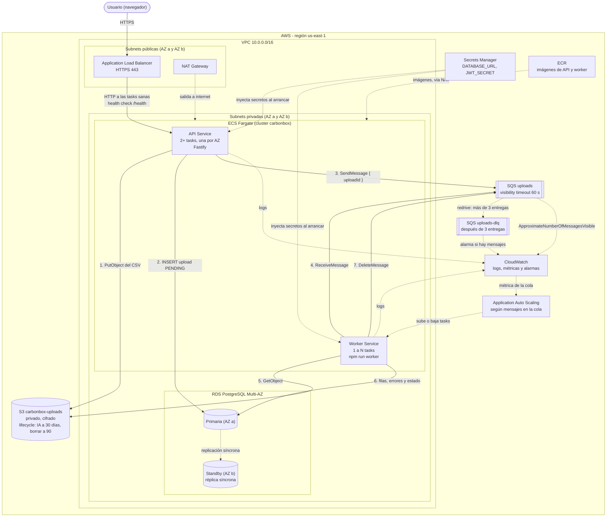

# Arquitectura en AWS

Cómo se desplegaría CarbonBox en AWS. Es el mismo código que corre en local: la API y el worker
ya usan el SDK oficial de AWS, y para pasar de LocalStack a AWS solo cambia la configuración
(ver "Pasar de LocalStack a AWS" en el [README](../README.md)).

## Diagrama

## Qué hace cada pieza y por qué

| Componente | Qué hace | Por qué así |
|---|---|---|
| **VPC con subnets públicas y privadas** | Separa lo que se ve desde internet de lo que no | Solo el ALB y el NAT viven en las públicas. La API, el worker y la base no tienen IP pública: nadie llega a ellos salvo pasando por el ALB |
| **Dos zonas de disponibilidad (AZ a y b)** | Cada capa tiene una copia en cada zona | Si se cae un datacenter entero, la aplicación sigue en el otro |
| **Application Load Balancer** | Recibe HTTPS y reparte entre las tasks de la API | Hace el health check contra `GET /health`, que ya existe (spec 001): si una task no responde o la base está caída, deja de mandarle tráfico |
| **ECS Fargate: API Service** | Corre la API (Fastify) en contenedores, sin administrar servidores | 2 o más tasks, una por zona, para alta disponibilidad. Es rápida: solo valida, guarda y encola (spec 003) |
| **ECS Fargate: Worker Service** | Corre `npm run worker` (spec 005) | Escala aparte de la API: si se suben muchos archivos, crecen los workers y la API ni se entera. Por eso son procesos separados desde el principio |
| **Auto scaling del worker** | Sube o baja la cantidad de tasks del worker | Según `ApproximateNumberOfMessagesVisible` de la cola (por ejemplo, 1 task cada 10 mensajes, entre 1 y 10). Es la métrica correcta: mide trabajo pendiente, no uso de CPU |
| **RDS PostgreSQL Multi-AZ** | La base, con una réplica síncrona en la otra zona | Si la primaria falla, RDS pasa a la standby solo, en uno o dos minutos y con la misma dirección. La app no cambia: es el mismo Prisma |
| **S3 privado** | Guarda los CSV originales (`uploads/<uuid>.csv`) | Privado y cifrado: solo las tasks pueden leer o escribir. La **lifecycle policy** pasa los archivos a almacenamiento más barato (Infrequent Access) a los 30 días y los borra a los 90: el archivo original se conserva un tiempo para reintentar o auditar, y después no ocupa lugar para siempre |
| **SQS + DLQ** | La cola entre la API y el worker | El visibility timeout (60 s) es mayor que lo que tarda procesar un archivo (~1 s para 10 MB). Si un mensaje falla 3 veces, la **redrive policy** lo mueve a `uploads-dlq` (spec 005, ya implementado en LocalStack) |
| **Secrets Manager** | Guarda `DATABASE_URL` (con la contraseña de la base) y `JWT_SECRET` | ECS los inyecta como variables de entorno al arrancar cada task: nunca están en el código, en la imagen ni en el repositorio. RDS puede rotar la contraseña sola |
| **CloudWatch** | Logs de las tasks, métricas y alarmas | Los logs de Fastify y del worker llegan por el driver `awslogs`. Alarmas útiles: mensajes en la DLQ (algo falla siempre), cola creciendo sin bajar, 5xx en el ALB |
| **NAT Gateway + ECR** | Salida a internet de las subnets privadas y el registro de imágenes | Las tasks bajan su imagen de ECR y hablan con las APIs de AWS sin tener IP pública. Para ahorrar NAT se pueden agregar VPC endpoints de S3, SQS, ECR y Secrets Manager |

## Permisos (IAM, mínimo privilegio)

Cada servicio tiene su propio **task role**, con solo lo que usa:

| Servicio | Permisos |
|---|---|
| API | `s3:PutObject` en `carbonbox-uploads/uploads/*` y `sqs:SendMessage` en `uploads` |
| Worker | `s3:GetObject` en `carbonbox-uploads/uploads/*` y `sqs:ReceiveMessage` / `sqs:DeleteMessage` en `uploads` |
| Los dos (execution role) | Leer sus secretos en Secrets Manager, bajar la imagen de ECR y escribir logs |

La base solo acepta conexiones desde el security group de las tasks, en el puerto 5432.

## El recorrido de un CSV

1. El usuario sube el CSV por HTTPS al **ALB**, que se lo pasa a una task de la **API**.
2. La API guarda el archivo en **S3**, registra el upload `PENDING` en **RDS** y publica
   `{ uploadId }` en **SQS**. Responde `202` en milisegundos.
3. Un **worker** recibe el mensaje, baja el CSV de S3, lo parsea, guarda filas y errores en RDS,
   marca el upload `COMPLETED` o `FAILED` y recién ahí borra el mensaje.
4. Si el worker falla (S3 o la base caídos), no borra el mensaje: SQS lo vuelve a entregar a
   los 60 s. Al tercer intento el upload queda `FAILED`, y si ni eso se puede, el mensaje va a la
   **DLQ** y salta una alarma en **CloudWatch**.
5. Si se acumulan mensajes, **Auto Scaling** agrega workers; cuando la cola se vacía, los quita.

## De local a AWS

| En local (Docker) | En AWS |
|---|---|
| Postgres en Docker | RDS PostgreSQL Multi-AZ |
| LocalStack: S3 y SQS | S3 y SQS reales (`AWS_ENDPOINT_URL` vacío) |
| `.env` con `test`/`test` | Task roles de IAM: el SDK toma las credenciales solo |
| `JWT_SECRET` y `DATABASE_URL` en `.env` | Secrets Manager |
| `npm run dev` y `npm run worker` | Dos servicios de ECS Fargate con la misma imagen y distinto comando |
| `localstack/ready.d/init-aws.sh` | Infraestructura como código (Terraform o CDK) |

El frontend (Next.js) no es parte de la consigna de AWS. Se podría servir como un tercer servicio
de ECS detrás del mismo ALB (`/` al frontend, `/api/*` a la API), o en Amplify o Vercel.
