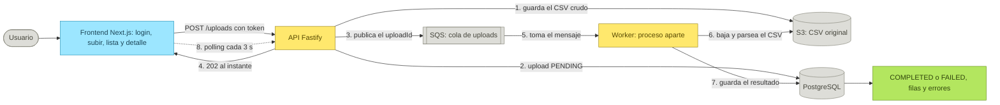
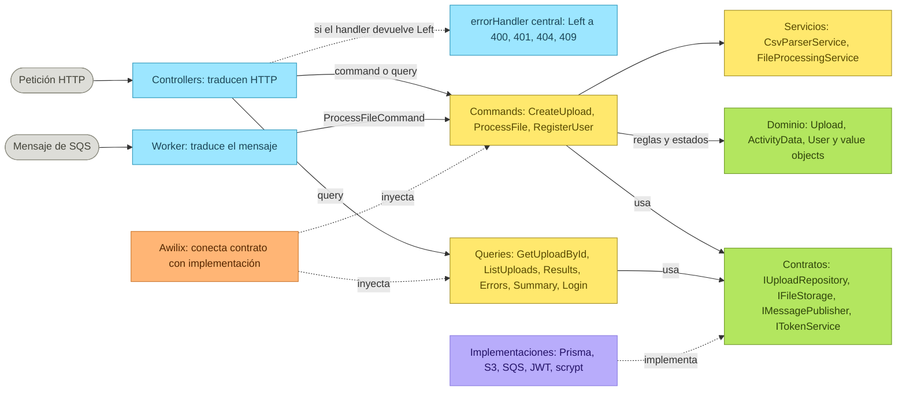
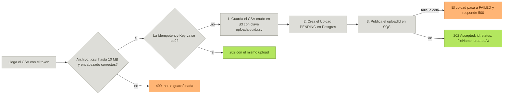
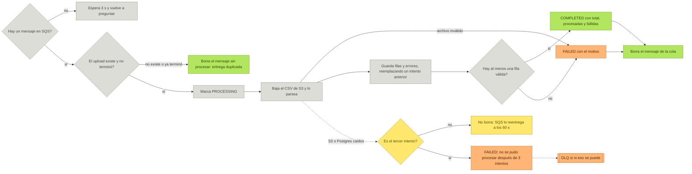
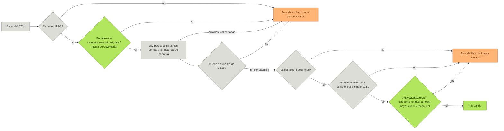
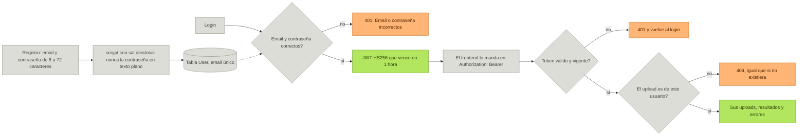
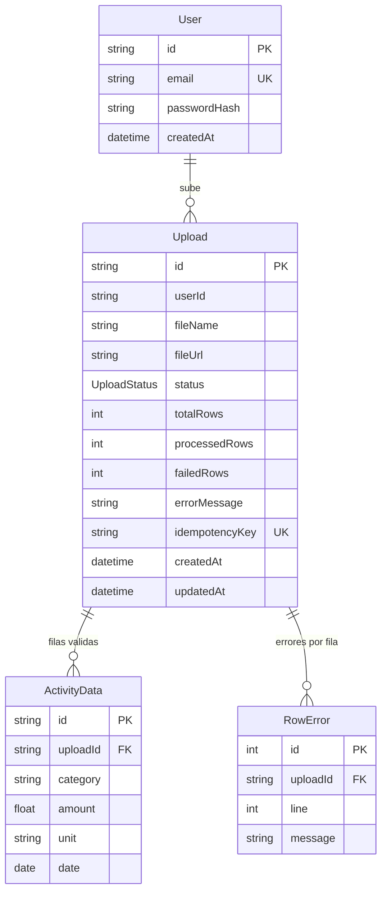
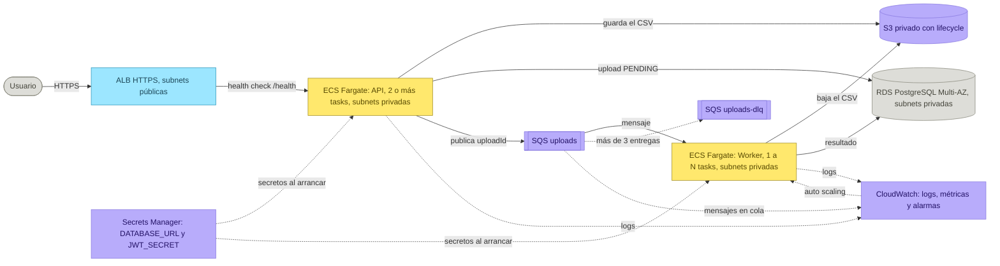

# CarbonBox: la arquitectura completa

Versión en el repositorio del tablero de Miro
[CarbonBox - Arquitectura completa](https://miro.com/app/board/uXjVEbWe1Fg=/). Mismo contenido,
frame por frame: un diagrama y el porqué de las decisiones. GitHub dibuja los diagramas Mermaid.

Colores: celeste = entradas (controllers, worker, frontend), amarillo = casos de uso, verde =
dominio y resultados correctos, violeta = infraestructura, naranja = arranque y errores, gris =
servicios externos.

1. [La app de punta a punta](#1-la-app-de-punta-a-punta)
2. [Backend: Clean Architecture + CQRS](#2-backend-clean-architecture--cqrs)
3. [La subida: POST /api/v1/uploads](#3-la-subida-post-apiv1uploads)
4. [El worker: procesamiento asíncrono](#4-el-worker-procesamiento-asíncrono)
5. [Parser y validaciones](#5-parser-y-validaciones)
6. [Login y seguridad](#6-login-y-seguridad)
7. [Modelo de datos](#7-modelo-de-datos)
8. [Las decisiones de arquitectura clave](#8-las-decisiones-de-arquitectura-clave)
9. [Despliegue en AWS](#9-despliegue-en-aws)
10. [Calidad y proceso](#10-calidad-y-proceso)

---

## 1. La app de punta a punta

**De la subida del CSV a los resultados.** Dos tiempos: la API responde en milisegundos (pasos 1
a 4) y el worker procesa en segundo plano (pasos 5 a 7). El frontend pregunta cada 3 s hasta que
el estado es final.

- **Qué resuelve.** Subir un CSV de datos de actividad (category, amount, unit, date), validarlo
  fila por fila, guardar lo válido y mostrar qué línea tiene cada error. Cada usuario ve solo sus
  archivos.
- **Por qué asíncrono.** Un archivo de 10 MB tiene cientos de miles de filas. Si la API las
  procesara, el usuario esperaría y un corte perdería el trabajo. Con la cola, la API responde ya y
  el worker reintenta si algo falla.
- **Stack.** Backend: Node, TypeScript, Fastify, Prisma, PostgreSQL, Awilix. Cola y archivos: SQS
  y S3 (LocalStack en local). Frontend: Next.js, React Query, Axios, Tailwind. Tests: Jest.

## 2. Backend: Clean Architecture + CQRS

**Cuatro capas, dependencias hacia adentro.** Las entradas (HTTP y cola) solo traducen a un
command o una query. Los casos de uso dependen de interfaces; Awilix les inyecta Prisma, S3, SQS o
un doble de test.

- **Por qué capas e interfaces.** El dominio no conoce Prisma ni Fastify. Los handlers dependen de
  contratos: en los tests se les inyectan dobles en memoria (sin base ni Docker) y en AWS las
  mismas clases de S3 y SQS, cambiando solo la configuración.
- **Por qué CQRS.** Cada operación es un command (escribe) o una query (lee), con su handler. Los
  casos de uso quedan chicos y se testean solos. Es CQRS de aplicación: misma base para leer y
  escribir, sin event sourcing, porque con este volumen no hace falta más.
- **Por qué Either.** Los errores esperables (validación, no encontrado) viajan como valor: Left o
  Right. El controller no tiene try/catch: si es Left lo lanza y un único errorHandler decide el
  código HTTP. Lo inesperado responde 500 sin detalles.

## 3. La subida: POST /api/v1/uploads

**Rápida: valida, guarda, encola y responde 202.** `CreateUploadCommandHandler`. Todo lo que
puede fallar al instante se revisa antes de escribir nada; las filas se validan después, en el
worker.

- **Por qué S3, después Postgres, después SQS.** Cada paso necesita el anterior: el Upload guarda
  dónde quedó el archivo y el mensaje lleva el id del Upload. La consigna lista la cola antes que la
  base; se invirtió para que el worker nunca reciba el id de un upload que no existe.
- **Por qué el mensaje lleva solo el id.** El CSV puede pesar 10 MB y un mensaje de cola es chico.
  La base es la única fuente de verdad: el worker busca ahí el resto. Si no se puede encolar, el
  upload queda FAILED: nunca en PENDING para siempre.
- **Por qué 202 e Idempotency-Key.** 202 significa recibido pero no procesado. Con la clave, un
  doble clic o un reintento devuelve el mismo upload; si dos llegan a la vez, el índice único deja
  pasar uno. Además el botón se deshabilita mientras sube.

## 4. El worker: procesamiento asíncrono

**Procesa, guarda y recién al final borra el mensaje.** `npm run worker`: proceso aparte con
polling cada 3 s. `FileProcessingWorker` traduce el mensaje, `ProcessFileCommandHandler` maneja
los estados y `FileProcessingService` hace el trabajo pesado.

- **Por qué borrar el mensaje al final.** SQS oculta el mensaje 60 s mientras se procesa. Si el
  worker se cae a la mitad, no se borró: reaparece y otro lo toma. Por eso ningún archivo se
  pierde. Los 60 s son más que lo que tarda procesar 10 MB (alrededor de 1 s).
- **Por qué idempotencia.** SQS entrega al menos una vez: el mismo mensaje puede llegar dos veces.
  Si el upload ya terminó, no se procesa. Si se reintenta, las filas y errores se reemplazan en una
  transacción: procesar dos veces da el mismo resultado.
- **Por qué negocio vs transitorio.** Un CSV inválido falla igual cada vez: se marca FAILED y se
  borra. Si se cae S3 o la base, se reintenta. Al tercer intento, FAILED: ningún upload queda en
  PROCESSING para siempre. La DLQ guarda lo que falla aunque todo lo demás falle.

## 5. Parser y validaciones

**Separa filas válidas de errores, con su línea.** `CsvParserService` con csv-parse. Un problema
del archivo entero lo rechaza; un problema de una fila solo descarta esa fila y dice en qué línea
está y por qué.

- **Por qué las reglas viven en el dominio.** La del encabezado está en `CsvHeader` y la usan la
  subida y el parser. Las de cada fila están en `ActivityData`. Ninguna se escribe dos veces: si
  cambia una regla, cambia en un solo lugar.
- **Por qué csv-parse y no split.** Con `split(",")` una fila correcta con una coma entre comillas
  se marcaría inválida. La librería se probó antes de usarla: con saltos de Windows dentro de un
  valor contaba líneas de más, y se normalizan a `\n`. 10 MB se parsean en 1 s.
- **Validar de verdad.** `new Date("2024-02-31")` no falla en JavaScript: se reconstruye la fecha y
  se compara. `Number("")` es 0 y `Number("1e3")` es 1000: amount se valida primero con una
  expresión regular. Cada error dice la línea, como en Excel.

## 6. Login y seguridad

**JWT: cada usuario ve solo lo suyo.** Contexto `auth` propio, con las mismas reglas que el resto.
Todas las rutas de uploads pasan por `adaptAuthenticatedRoute`, que valida el token antes de llegar
al controller.

- **Por qué login, si la consigna no lo pide.** La lista y el dashboard son "del usuario": con un
  usuario fijo (user-123) no se puede probar que uno no vea lo de otro. El registro es un command y
  el login una query: no escribe nada, solo firma un token.
- **Por qué 404 y no 403.** Un 403 confirmaría que ese upload existe. Respondiendo 404, un usuario
  no puede averiguar los ids de otros. Por lo mismo, el login no dice si falló el email o la
  contraseña.
- **Secretos y tokens.** `JWT_SECRET` de al menos 32 caracteres, en `.env` (que no se versiona) y
  en AWS en Secrets Manager. Al verificar se fija el algoritmo HS256: un token con `alg: none` se
  rechaza. scrypt y JWT están detrás de interfaces.

## 7. Modelo de datos

**Cuatro tablas en PostgreSQL.** Prisma con migraciones versionadas. Las entidades de dominio no
son las filas de Prisma: un mapper traduce entre las dos, así el dominio no depende de la base.

- **Estados que protege la entidad.** PENDING a PROCESSING a COMPLETED o FAILED. También PENDING a
  FAILED (no se pudo encolar) y PROCESSING a PROCESSING (reintento). Cualquier otro cambio lo
  rechaza `Upload`: ni la API ni el worker pueden dejarlo en un estado imposible.
- **Reemplazar, no agregar.** Guardar las filas o los errores de un upload borra los de un intento
  anterior e inserta los nuevos en una sola transacción. Así un reintento no duplica nada y
  procesadas + fallidas siempre es igual a total.
- **Detalles que importan.** `status` es un enum de Postgres: la base rechaza estados inválidos.
  `date` es DATE y no fecha con hora: no se corre por zona horaria. Índices en `uploadId` para leer
  rápido, y únicos en `email` e `idempotencyKey`.

## 8. Las decisiones de arquitectura clave

**Nueve decisiones y por qué se tomaron.** Lo más importante para defender el proyecto. Cada una
tiene su detalle y sus alternativas descartadas en el `research.md` del spec correspondiente.

1. **Procesamiento asíncrono con una cola.** La API valida, guarda y encola; un worker aparte
   procesa. La subida responde en milisegundos aunque el CSV tenga cientos de miles de filas, y si
   algo falla se reintenta sin que el usuario haga nada.
2. **Orden: S3, Postgres y después SQS.** Al revés de la consigna, a propósito: el registro existe
   antes de publicar el mensaje, así el worker nunca recibe el id de un upload inexistente. Si no
   se puede encolar, el upload queda FAILED y no en PENDING para siempre.
3. **El mensaje lleva solo el uploadId.** El archivo va a S3 y el estado a Postgres, que es la
   única fuente de verdad. El mensaje queda chico y el worker siempre lee el estado actual, no una
   copia vieja.
4. **SQS y S3 reales con LocalStack.** La API y el worker son procesos separados: un array en
   memoria no sirve. Se usa el SDK oficial contra LocalStack (fijado en 4.14.0, la última sin
   token): pasar a AWS es cambiar el `.env`. Se descartó una tabla como cola: habría que programar
   a mano lo que SQS ya trae.
5. **Idempotencia en todos los niveles.** Subida: Idempotency-Key con índice único. Worker: si el
   upload ya terminó no se procesa, y las filas se reemplazan en cada intento. Resultado: un doble
   clic o una entrega repetida de SQS nunca duplican datos.
6. **Clean Architecture, CQRS y Either.** Dominio sin dependencias de librerías, handlers que
   dependen de interfaces y devuelven Either, controllers y worker sin lógica ni try/catch. Todo se
   testea con dobles, sin base ni Docker.
7. **Las reglas viven en el dominio.** `Upload` decide qué cambios de estado valen, `ActivityData`
   valida cada fila y `CsvHeader` el encabezado. La subida y el parser reutilizan las mismas
   reglas: nunca dos versiones distintas de lo mismo.
8. **Error de negocio o transitorio.** Un archivo inválido falla igual siempre: FAILED y se borra
   el mensaje. Una base o un S3 caídos se reintentan; al tercer intento, FAILED. La DLQ guarda lo
   que no se pudo ni marcar. Ningún upload queda colgado.
9. **Login con JWT y datos por usuario.** Agregado al alcance: cada ruta de uploads exige token y
   cada consulta filtra por el usuario. Lo ajeno responde 404, no 403, para no revelar que existe.
   Contraseñas con scrypt y secretos fuera del repo.

## 9. Despliegue en AWS

**El mismo código, en AWS.** VPC con subnets públicas (solo el ALB) y privadas (servicios y base),
en dos zonas de disponibilidad. S3, SQS, Secrets Manager y CloudWatch son servicios
administrados, fuera de la VPC. El detalle está en [arquitectura-aws.md](arquitectura-aws.md).

- **Alta disponibilidad.** Dos o más tasks de la API, una por zona, detrás del ALB, que solo manda
  tráfico a las que responden `/health`. RDS Multi-AZ pasa a la réplica sola si se cae la primaria.
- **Escala según la cola.** El worker escala con la cantidad de mensajes en SQS, no con la CPU:
  mide trabajo pendiente. Por eso API y worker son procesos separados desde el principio: crecen
  por separado.
- **Mínimo privilegio.** Cada servicio tiene su rol IAM: la API solo puede escribir en S3 y
  publicar en SQS; el worker solo leer de S3 y recibir y borrar de SQS. La base solo acepta
  conexiones de las tasks.

## 10. Calidad y proceso

**Cómo se construyó y cómo se verificó.** Funciona de punta a punta, está testeado y cada decisión
está escrita. Esto es lo que respalda todo lo anterior.

- **346 tests, escritos antes del código (TDD).** Unitarios del dominio, el parser (48, uno de los
  bonus), handlers, controllers y worker con dobles. HTTP con la app real. Integración contra
  Postgres y LocalStack, incluido el flujo completo subida, worker y base. Se verifica con el
  código de salida de Jest.
- **Siete specs con Spec Kit.** 001 base, 002 dominio y persistencia, 003 subida, 004 parser, 005
  worker, 006 consultas, 007 frontend y login. Cada uno con spec, plan, research, tareas y su rama.
  Commits atómicos y una constitución con las reglas no negociables.
- **Frontend.** Next.js con React Query: dashboard con datos reales, lista paginada con badges por
  estado, subida con progreso y detalle con polling cada 3 s que se corta solo al terminar. El
  diseño está separado de la lógica: componentes de vista y hooks.
- **Uso de IA documentado.** [USO-DE-IA.md](../USO-DE-IA.md) registra qué generó la IA, qué se
  corrigió y qué se aprendió en cada spec. Por ejemplo: un test desmintió una conclusión de la
  investigación, o la IA probó las librerías antes de elegirlas.
- **Limitaciones conocidas** (en el [README](../README.md)). LocalStack no guarda nada entre
  reinicios. Si fallan a la vez la cola y la base, un upload puede quedar PENDING (la solución es el
  patrón outbox). Un archivo puede quedar huérfano en S3 (lo limpia la lifecycle policy).
- **Cómo correrlo.** `docker compose up -d --wait`. En `backend`: `npm install`,
  `npm run db:deploy`, `npm run dev` y `npm run worker`. En `frontend`: `npm install` y
  `npm run dev`. Abrir `localhost:3001`, crear cuenta y subir `sample-data.csv`.
